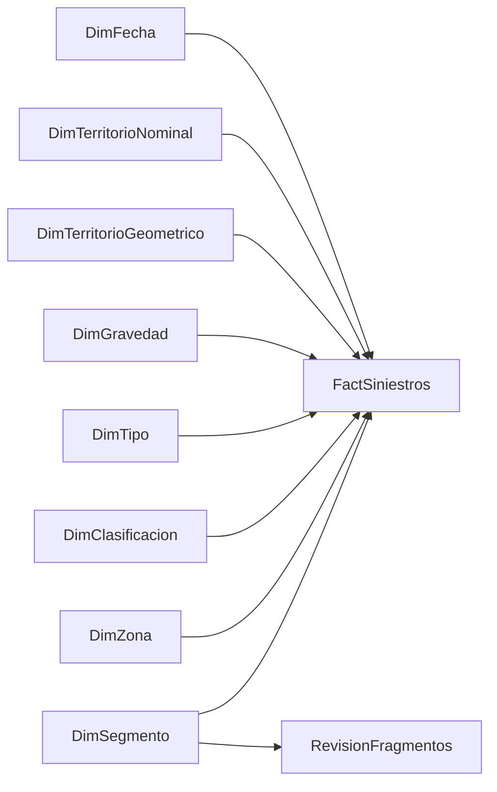

# Modelo de datos recomendado

## Grano y fuentes

Importación local. **FactSiniestros: una fila por evento_id de la fuente**, 8332
filas; no una fila por víctima, vehículo, fragmento o celda. No anexar ninguno
de los siete CSV resumen a los hechos. Esos resúmenes son controles independientes.

Partir de [hechos_siniestros.csv](../geospatial/hechos_siniestros.csv), sin
reclasificar. La propuesta en Power Query añade fecha_siniestro y latitud/longitud
desde [siniestros_comuna3_limpios.csv](../../data/processed/siniestros_comuna3_limpios.csv)
por evento_id=objectid, con comprobaciones de unicidad, correspondencia 1:1 y
conteo. Solo importar esas cuatro columnas auxiliares; no dirección, radicado ni hora.

Microsoft recomienda separar dimensiones para filtrar/agrupaciones y hechos
para resumir; aquí evita repetir los eventos al incorporar segmentos y zonas.
[Guía oficial del modelo estrella](https://learn.microsoft.com/en-us/power-bi/guidance/star-schema).

## Tablas propuestas

| Tabla | Grano / cantidad actual | Clave y atributos |
|---|---|---|
| FactSiniestros | Evento / 8332 | evento_id texto único; fecha; claves de dimensiones; distancias decimales; flags lógicos; latitud/longitud decimales |
| DimFecha | Día / 2557 días, 2019-01-01 a 2025-12-31 | Fecha única, Año, MesNumero, Mes, AñoMes, OrdenAñoMes, trimestre |
| DimTerritorioNominal | Par num_comuna+barrio / 18 | TerritorioId entero sustituto, ambos textos originales; todos nominalmente Comuna 3 |
| DimTerritorioGeometrico | Valor territorio_geometrico / 4 | TerritorioGeometrico texto único: Manrique, Aranjuez, Santa Elena, Popular |
| DimGravedad | Etiqueta / 2 | gravedad_siniestro texto único: HERIDOS, DAÑOS |
| DimTipo | Etiqueta / 5 | clase_siniestro texto único; no inventar categorías nuevas |
| DimClasificacion | Categoría / 5, cuatro usadas | categoria_analisis texto, descripción, flags; incluye reserva sin posición |
| DimZona | Celda / 439 + miembro SIN_ZONA | zona_id texto, prioritaria lógica, atributos estáticos del cierre |
| DimSegmento | Entidad vial / 26 | segmento_cercano_id entero, longitud_m decimal, válida/duplicada lógicas |
| RevisionFragmentos | Parte / 6 | parte_id texto único; objectid entero; longitud; clasificación y decisión |

DimFecha se genera como calendario continuo y se marca como tabla de fechas.
El CSV principal solo tiene año/mes: no inventar el día 1 como fecha del evento.
La unión auxiliar propuesta recupera la fecha real ya existente. Si no se permite
esa unión en la implementación, usar DimMes (84 filas) y limitar el análisis a
meses/años, sin declarar inteligencia temporal diaria.
[Requisitos de tabla de fechas](https://learn.microsoft.com/en-us/power-bi/guidance/model-date-tables).

## Relaciones propuestas, todas activas y unidireccionales

| Lado 1 | Lado N | Cardinalidad | Observación |
|---|---|---|---|
| DimFecha[Fecha] | FactSiniestros[fecha_siniestro] | 1:N | Misma fecha sin componente de hora |
| DimTerritorioNominal[TerritorioId] | FactSiniestros[TerritorioId] | 1:N | ID generado en dimensión; merge por las dos columnas naturales |
| DimTerritorioGeometrico[TerritorioGeometrico] | FactSiniestros[territorio_geometrico] | 1:N | No relacionar entre sí las dos dimensiones territoriales |
| DimGravedad[gravedad_siniestro] | FactSiniestros[gravedad_siniestro] | 1:N | No relacionar por texto normalizado sin conservar significado |
| DimTipo[clase_siniestro] | FactSiniestros[clase_siniestro] | 1:N | Cinco valores actuales |
| DimClasificacion[categoria_analisis] | FactSiniestros[categoria_analisis] | 1:N | 604/40/4/7684; reserva con cero filas |
| DimZona[zona_id] | FactSiniestros[zona_id_modelo] | 1:N | 44 nulos se representan como SIN_ZONA solo en el modelo |
| DimSegmento[segmento_cercano_id] | FactSiniestros[segmento_cercano_id] | 1:N | Vecino más cercano, no atribución vial |
| DimSegmento[segmento_cercano_id] | RevisionFragmentos[objectid] | 1:N | Tabla auxiliar de revisión; no unirla físicamente con hechos |

El flujo de filtro siempre va de dimensión hacia hechos/revisión. No crear
relación zona→barrio→hechos ni segmento→zona→hechos: generaría rutas alternativas
y supuestos territoriales no verificados. No usar relaciones N:N o bidireccionales.

## Tipos y reglas de uso

- Identificadores de evento, celda, parte y categoría: texto, **no resumir**.
- Año/mes, claves enteras y conteos: entero; claves tampoco se suman.
- Fechas: Date. Latitud/longitud: decimal, categorías geográficas correspondientes,
  no resumir. Usar evento_id para distinguir eventos coincidentes en el mapa.
- Distancias/longitudes: decimal en metros; no medir de nuevo en Power Query.
- Flags True/False: logical. No convertir nulos en cero ni falso indiscriminadamente.
- zona_id original se conserva; zona_id_modelo sustituye únicamente nulos por
  SIN_ZONA. Agregar una única fila explícita a DimZona en memoria, con prioritaria=false.
- Ocultar claves, flags redundantes y atributos estáticos sumables del panel de
  campos para usuarios finales; exponer medidas con nombres claros.

Las 12 zonas prioritarias son **una clasificación exploratoria fija del cierre**.
Al filtrar por año/gravedad cambia [Registros] de cada celda, no su condición de
prioridad. No sumar zonas.cantidad para gráficos filtrados: es un conteo estático
de todo el período. Las 44 filas SIN_ZONA deben seguir visibles en calidad.

La dimensión nominal tiene 18 pares reales; no es un catálogo oficial completo
de barrios. La distribución geográfica observada suma 8288 Manrique, 40 Aranjuez,
tres Santa Elena y uno Popular; no reemplaza el num_comuna original.
